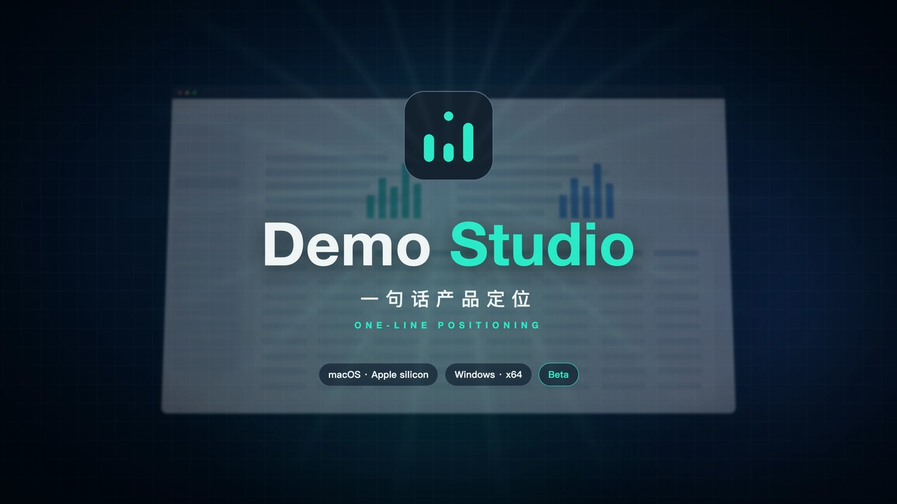
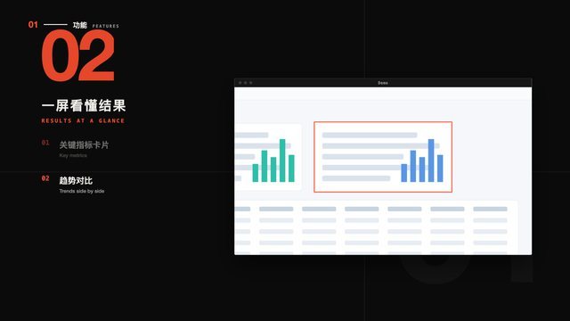
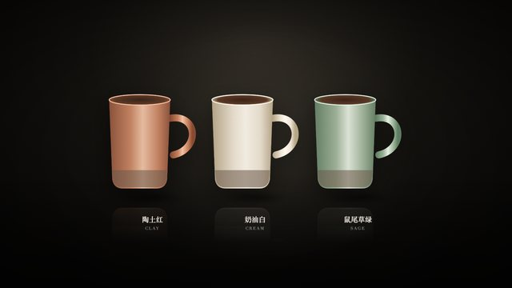
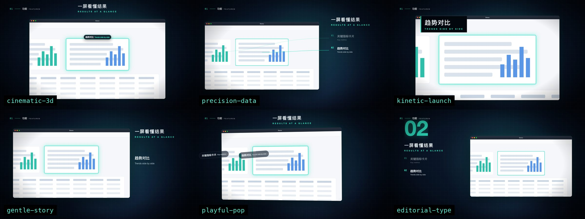
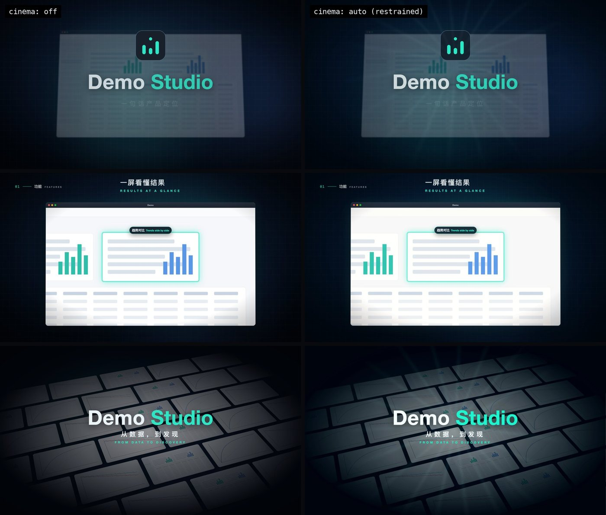

# product-promo-film

**Commercial-grade promo films for any product, from a folder of materials: an agent skill.**
**任何产品，一个素材文件夹，做出商业级宣传片：给 AI 智能体用的 skill。**

[English](#english) · [中文](#中文)



<a id="english"></a>
## English

Point an AI coding agent at a folder: screenshots, product photos or cut-outs, clips, a logo and a README. Music is optional. It produces a 1080p film of 45 s to 4 min (the length follows the materials) with:
- a cover poster;
- real material animated with restraint, cut on the beat;
- an original underscore when you have no track;
- a natural English voice-over (local, open-source TTS);
- bilingual captions and SRT;
- an end card with your motto and contacts.

It works for software, apps, hardware, fashion, food, services, places and brands.


### How it gets to a top-tier result
- **It understands the product.**
  - `genres.py` classifies it into one of 15 genres (SaaS, developer and AI tools, science, fintech, consumer apps, electronics, fashion and luxury, food and drink, health, education, mobility, travel and living, games and events, kids, brand and mission). That sets the look, the motion, the story arc and the music.
  - `intake.py` tells screens, photos, cut-outs, figures and logos apart.
- **One folder, one command to a draft.** `autofilm.py <folder>` casts every material into the beat that suits it (reveal, detail, range, proof, hero…). It writes `film.json` and a `treatment.md` for the crew.
- **A built-in crew** (`references/crew.md`): producer, strategist, creative director, copywriter, a high-taste art director, motion designer and editor, composer, brand guardian and design critic. They write a treatment with three concepts, one chosen idea, a hook in 3 s, one hero moment, a tagline and a script.
  - `check_treatment.py` blocks the build until it is complete, consistent and scores ≥ 4/5 on taste. It also checks quality, not just form: proof lines must carry facts from the docs, the chosen concept must reach the film, film.json must say what the treatment says, and each self-score is capped by what the film can be measured to show.
  - `lint_copy.py` removes clichés and flags vague words.
  - **Golden films** (`templates/golden/`, one per story arc, every scene with a `_why`) and a **copy bank** (`references/copy-bank.md`) give mid-sized models something top-level to imitate.
- **No music? It composes one.** `make_music.py` writes an original, royalty-free underscore bar for bar from the scene plan. Sections change on the cuts, half a beat of silence falls before the hero, and the end rings out. There are 7 moods, from cinematic pulse to warm acoustic and luxe lounge.
- **The film is data, not code.**
  - `film.json` picks from 17 scene types: cover · pain · feature · carousel · numbers · gallery · clip · phone · compare · statement · finale · endcard, plus photo · hero · detail · lineup · quote for physical products, places and people.
  - `make_film.py` runs check → build → voice → QA → render → finish, and every error prints a `FIX:` line.
- **A restrained director's cinema layer:** a colour script, a LUT grade, adaptive 180° motion blur, a subtle lens and light, and quiet synthesised sound design. Effects are felt, not seen.
- **Automatic layout QA** measures overlaps, off-frame content and caption collisions, so mid-sized models ship clean frames.
- **Highlight boxes without measuring:** `suggest_rects.py` finds the cards, panels, charts and tables in a screenshot; autofilm pre-fills feature points with them.
- **Enforced gates:** no build before the treatment passes, no render before QA passes, no hand edits in `film_out/`, no downloads without the user's OK.
- **Measured on smaller models:** given one line, Claude Haiku's films matched the film Claude Opus made on the same materials (within critic noise) and beat it on others, in blind panels of three independent critics, with every honesty gate passing. `evals/` holds the test folders, the method and the full report ([evals/REPORT.md](evals/REPORT.md)).

### 8 visual styles × 6 motion languages
The look and the movement are chosen separately. Both follow the product's genre and theme.

| Style | Preview | Default motion | Suits |
| --- | --- | --- | --- |
| `midnight-tech` |  | `cinematic-3d` | platforms, B2B, serious tech |
| `keynote-light` |  | `gentle-story` | consumer & productivity, care, hardware |
| `editorial-mono` |  | `editorial-type` | manifesto, brand, opinion |
| `aurora-glass` |  | `playful-pop` | consumer, creators, kids |
| `neon-cyber` |  | `kinetic-launch` | dev tools, AI agents, games, events |
| `paper-academic` |  | `precision-data` | science, data, research, finance |
| `luxe-noir` |  | `gentle-story` | fashion, beauty, jewellery, premium hardware |
| `natural-fresh` |  | `gentle-story` | food & drink, wellness, travel, home, family |

The feature walkthrough has a different layout in each motion language:



### Director's cinema layer: restrained, professional, premium
How a top commercial director works is turned into automatic defaults. The guide is [references/director.md](references/director.md).
- **Colour:** a colour script (cold "before", honest product, a slightly richer peak, a warm close), and a LUT per style blended at 50 % so real UI and product colours stay true.
- **Camera:** barely-there handheld, edge depth of field and a focus pull. Camera cuts happen only where the story turns.
- **Light:** soft glints, faint rays, and one anamorphic flare on the hero moment.
- **Sound:** about 10 quiet cues a minute, under the music.
- **Control:** `"cinema": "auto"` is the default; `"off"` turns it off; an object tunes it. `--draft` gives quick looks.



### Install
```bash
git clone https://github.com/CalebChen941028/product-promo-film.git
cd product-promo-film
./install.sh                 # ~/.agents/skills + Claude Code + Codex   (Windows: .\install.ps1)
./install.sh all             # + OpenCode, Antigravity, DeepSeek Harness, Kimi Code, Cursor, Copilot, Gemini CLI, Qwen Code, Trae
npm i playwright && npx playwright install chromium
python3 scripts/doctor.py
```
Where each agent looks for skills: [references/agents.md](references/agents.md). Agents without skill support: point them at [AGENTS.md](AGENTS.md).

### Quick start
Ask your agent: *"Make a promo film for my product from ~/materials with the product-promo-film skill."* It follows [SKILL.md](SKILL.md):
```bash
python3 scripts/autofilm.py ~/materials --out ~/my-film      # draft: genre, look, arc, music, film.json, treatment.md
# the crew fills treatment.md and every TODO (references/crew.md), then:
python3 scripts/check_treatment.py ~/my-film/treatment.md ~/my-film/film.json
python3 scripts/make_film.py ~/my-film/film.json              # check → build → voice → QA → render → finish
```
Examples:
- [examples/product-demo](examples/product-demo): a physical product, no music supplied, with the full crew treatment.
- [examples/demo](examples/demo): software, the user's track.
- [examples/medstat-pilot](examples/medstat-pilot): a 3:26 production film.

### Requirements
- Python 3.9+ with numpy and Pillow.
- Node 18+ with Playwright (Chromium).
- ffmpeg (`pip install imageio-ffmpeg` works).
- Optional, for the voice-over: Kokoro (Apache-2.0) in a Python 3.12 venv; see [references/audio.md](references/audio.md).

### Docs
- [SKILL.md](SKILL.md): the procedure.
- [crew](references/crew.md): the roles and the taste rubric.
- [copy bank](references/copy-bank.md) and [golden films](templates/golden): what top-level copy and structure look like, per arc and genre.
- [genres](references/genres.md): product type → look, motion, music, arc.
- [director](references/director.md): colour, camera, light, sound, restraint.
- [film-spec](references/film-spec.md): every `film.json` field.
- [materials](references/materials.md): what to put in the folder.
- [styles](references/styles.md), [motion](references/motion.md), [audio](references/audio.md).
- [storyboard](references/storyboard.md), [capture](references/capture.md), [qa](references/qa.md), [troubleshooting](references/troubleshooting.md), [agents](references/agents.md).

### Credits & licences
- **This skill:** MIT. © 2026 Liangliang Chen (陈亮亮), [github.com/CalebChen941028](https://github.com/CalebChen941028), WeChat official account 科研牛马研习社. Built with Codex & Claude.
- **Not bundled, installed by you:** Playwright (Apache-2.0), Kokoro-82M (Apache-2.0), ffmpeg (LGPL/GPL builds).
- **Demo music** (`examples/demo/demo-music.m4a`): original, CC0. Music composed by `make_music.py` is yours to use.
- **Placeholders:** the product-demo images are drawn placeholders for a fictional brand.
- Use only material, music and voices you have the rights to.

<a id="中文"></a>
## 中文

把一个文件夹交给 AI 编程智能体：截图、产品照片或透明底产品图、录屏、Logo、README，音乐可有可无。它会做出一部 45 秒到 4 分钟的 1080p 宣传片（片长取决于素材多少）：
- 封面海报；
- 克制而有节奏的真实素材动效，切点卡在节拍上；
- 没有音乐时自动原创配乐；
- 自然的英文配音（本地开源 TTS）；
- 中英双语字幕与 SRT；
- 带理念和联系方式的结尾页。

适用于软件、App、硬件、时尚、食品、服务、空间与品牌。

### 怎样做到顶级效果
- **先理解产品**：
  - `genres.py` 把产品归入 15 类之一（SaaS、开发者与 AI 工具、科研、金融、消费级 App、消费电子、时尚奢品、食品饮品、健康、教育、出行工业、旅行家居、游戏活动、儿童、品牌公益），据此决定风格、动效、叙事结构与音乐。
  - `intake.py` 自动区分界面截图、照片、透明底产品图、图表与 Logo。
- **一个文件夹，一条命令出草稿**：`autofilm.py <文件夹>` 把每份素材分配到最合适的拍点（揭晓、细节、系列、证明、高潮……），写出 `film.json` 和供团队填写的 `treatment.md`。
- **内置制作团队**（`references/crew.md`）：制片、策略、创意总监、文案、高品味美术指导、动效与剪辑、作曲、品牌把关、设计评审。他们产出包含三个概念、选定创意、3 秒钩子、唯一高潮、口号与脚本的创意方案。
  - `check_treatment.py` 在方案完整、一致且品味评分 ≥ 4/5 之前阻止构建；它也检查质量而不只是格式：证据句要带文档里的事实，选定的创意要进入片子，film.json 要与方案一致，自评分会被片子可测量的表现封顶。
  - `lint_copy.py` 清除空话套话，并标出含糊的词。
  - **范例片**（`templates/golden/`，每种叙事结构一部，每个场景都有 `_why`）与**文案范例库**（`references/copy-bank.md`），让中等规模的模型有顶级水准可以模仿。
- **没有音乐就作曲**：`make_music.py` 按场景逐小节原创无版权配乐，段落在切点变化，高潮前留半拍静默，结尾自然收束；有七种情绪可选。
- **片子是数据而不是代码**：
  - `film.json` 从 17 种场景中选择；新增的 photo · hero · detail · lineup · quote 用于实物产品、空间与人物。
  - `make_film.py` 一条命令完成检查到交付，出错时给出 `FIX:`。
- **克制的导演电影层**：色彩脚本、LUT 调色、自适应 180° 运动模糊、含蓄的镜头与光效、轻声的合成声音设计；效果感受得到，看不出来。
- **自动版式 QA**：用数值检测重叠、出画、字幕冲突，中等规模的模型也能交出干净的画面。
- **高亮框不用手量**：`suggest_rects.py` 自动找出截图里的卡片、面板、图表和表格，autofilm 用它预填功能要点。
- **强制关卡**：方案未通过不构建，QA 未通过不渲染，不许手改 `film_out/`，未经用户同意不下载。
- **在较小模型上实测**：只给一句提示，Claude Haiku 做出的片子在三位独立评审的盲评中，同一素材上与 Claude Opus 制作的片子持平（在评审波动范围内），其他素材上超过它，且所有诚实性关卡都通过。`evals/` 里有测试素材、方法和完整报告（[evals/REPORT.md](evals/REPORT.md)）。

### 8 种视觉风格 × 6 种动效语言
风格与动效分开选择，都依据产品类型与主题；对照表与预览见上方英文部分。新增 `luxe-noir`（安静的奢华感：时尚、美妆、珠宝、高端硬件）与 `natural-fresh`（日光与材质：食品、身心健康、旅行、家居、亲子）。

### 安装与快速开始
命令见上方英文部分。对智能体说：“用 product-promo-film skill，根据 ~/materials 里的素材给我的产品做一部宣传片”，它会按 [SKILL.md](SKILL.md) 执行。示例：
- [examples/product-demo](examples/product-demo)：实物产品，无音乐，含完整团队方案。
- [examples/demo](examples/demo)：软件，使用用户音乐。
- [examples/medstat-pilot](examples/medstat-pilot)：3:26 正式成片。

### 署名与许可
- **本 skill**：MIT 许可。© 2026 陈亮亮，[github.com/CalebChen941028](https://github.com/CalebChen941028)，微信公众号：科研牛马研习社。由 Codex 与 Claude 协作开发。
- **不随仓库分发、需自行安装**：Playwright、Kokoro-82M、ffmpeg。
- **示例音乐**：原创，CC0；`make_music.py` 生成的配乐可自由使用。
- **占位图**：产品示例中的图片是虚构品牌的绘制占位图。
- 请只使用你有权使用的素材、音乐和声音。
